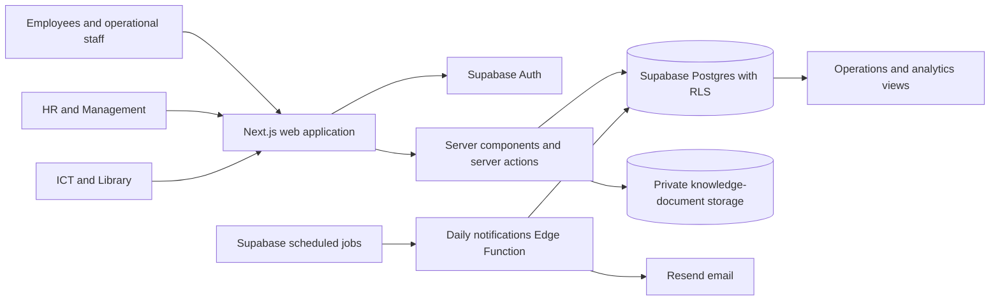

# CUT-ELAMS

CUT-ELAMS (the Retain application) is Chinhoyi University of Technology's web platform for employee lifecycle workflows, leave, asset accountability, knowledge handover, and HR/management reporting.

> **Deployment status:** application code and database migrations are in this repository. A successful local build does not prove that migrations, Supabase Storage policies, scheduled jobs, email delivery, or role access have been validated in the institution's live project. Follow the deployment and acceptance checklists before production use.

## What the system does

- **Employee records and recruitment mapping:** manage employee profiles and planned openings by role, department, category, position count, start date, and pipeline stage. Openings are planning records, not candidate application tracking.
- **Leave self-service:** employees request leave; HR configures year/type balances and reviews requests. Server and database checks enforce the configured balance rules.
- **Asset accountability:** ICT and Library staff manage assignment, return receipt, verification, and daily activity logs for checks, movement, maintenance, issues, and returns.
- **Digital exit clearance:** HR coordinates departmental steps. Finalization is blocked until applicable clearance steps are approved, assigned assets are returned and verified, and mandatory applicable knowledge documents are approved. Account deactivation is separately blocked until the digital exit is complete.
- **Knowledge handover:** staff upload documents to private Supabase Storage; configured reviewers approve or request changes. Technical employees require an approved handover and configured applicable requirements before finalization.
- **Analytics:** quarterly turnover/exit-driver reports, review-turnaround measures, commute-distance groupings, and a provisional rule-based flight-risk indicator.
- **Administration and alerts:** administrators assign roles; HR manages permitted account/workflow operations; users receive in-app notifications and configurable scheduled email digests with audit events.

The risk score is an **unvalidated HR review prompt**, not a prediction of an employee's intent or a basis for employment decisions. Its inputs, rules, and validation limits are documented in the [system overview](docs/system-overview.md).

## How it works



For request flows, data relationships, daily jobs, and safeguards, see [How the system works](docs/system-overview.md).

## Quick start

Requirements: Node.js 22 and pnpm. From the repository root:

```bash
pnpm install --frozen-lockfile
cp .env.example .env.local
```

Set `NEXT_PUBLIC_SUPABASE_URL`, `NEXT_PUBLIC_SUPABASE_PUBLISHABLE_KEY` (or the legacy `NEXT_PUBLIC_SUPABASE_ANON_KEY`), and the server-only `SUPABASE_SERVICE_ROLE_KEY` in `.env.local`. Set `NEXT_PUBLIC_APP_URL` to the public application URL. Never use a `NEXT_PUBLIC_` prefix for a service-role/secret key.

```bash
pnpm dev
```

Open [http://localhost:3000](http://localhost:3000). The application expects a Supabase project with the migrations and private `knowledge-documents` Storage bucket configured. Detailed local, staging, and production steps are in [Deployment](docs/deployment.md).

Before proposing a change, run:

```bash
pnpm lint
pnpm typecheck
pnpm build
```

## Scope and important limits

Payroll processing, student management, attendance tracking, candidate application tracking, and automatic salary disbursement are outside this application's scope. The digital exit gate controls **application exit finalization**; it is not connected to payroll and does not itself stop or release a payment. If the institution needs a payroll hold, that must be designed and approved as a separate integration with explicit ownership and authorization rules.

Institutional targets such as 100% asset visibility and a 35% leave-turnaround reduction require operational baselines and measurement. They are goals, not outcomes guaranteed by the code.

## Documentation

- [How the system works](docs/system-overview.md) — architecture, diagrams, data flow, roles, workflows, analytics, and boundaries.
- [Deployment guide](docs/deployment.md) — environment setup, ordered database rollout, Storage, email, scheduled jobs, and post-deployment checks.
- [Operations guide](docs/operations.md) — daily routines, monitoring, recovery, and acceptance scenarios.
- [Security model](docs/security.md) — trust boundaries, role checks, RLS, secrets, and handling staff data.
- [Original project brief](docs/project-brief.md) — objectives and explicit scope boundaries supplied by the product owner.
- [Requirements audit](docs/requirements-audit.md) — traceability to the supplied project brief, with code versus live-validation status.
- [References](docs/references.md) — official GitHub, Next.js, and Supabase guidance used by this repository.
- [Contributing](CONTRIBUTING.md), [security reporting](SECURITY.md), and [support](SUPPORT.md).

## Technology

Next.js 16 App Router, React 19, TypeScript, Tailwind CSS, Supabase Auth/Postgres/Storage, and a Deno Supabase Edge Function for scheduled notifications.

## Database changes

SQL migrations live in `supabase/migrations/`. Review their status against the target database before deployment; never apply them to production just because a local build passes. The repository currently does not contain an institutional production-verification record. See the [deployment guide](docs/deployment.md).

## License and data ownership

This is an internal institutional system. No open-source license is declared in this repository. Employee records and uploaded handover documents remain institutional data and must be handled under CUT's approved policies.
