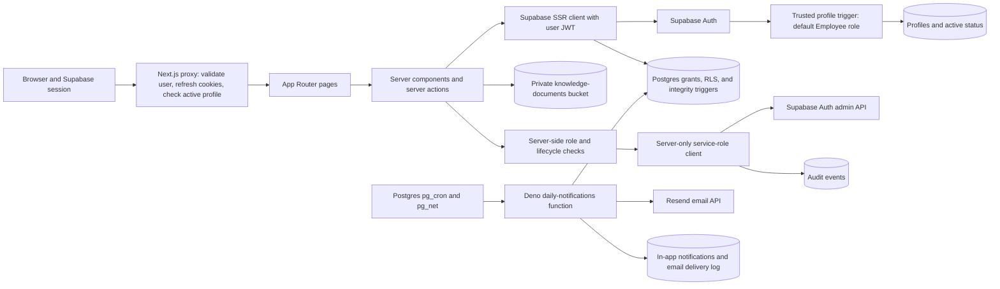
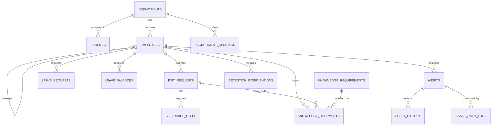
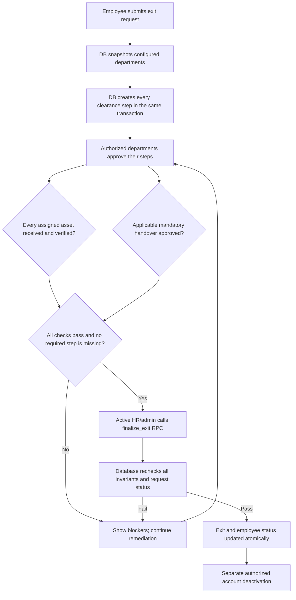

# How CUT-ELAMS works

This document describes behavior implemented in the repository. It distinguishes source-code behavior from Supabase configuration and live operational results, which still require environment-specific validation.

## Architecture and trust boundaries

The browser uses Supabase Auth sessions through the Next.js App Router. The root `proxy.ts` asks Supabase to validate the session, refreshes cookies, checks whether a protected profile is active, and redirects unauthenticated or deactivated users away from protected pages. A trusted database trigger creates new Auth users' profiles with the least-privileged `Employee` role. The app no longer lets an account recreate a missing profile; missing or inactive profiles fail closed. PostgreSQL Row Level Security (RLS) provides a second authorization boundary for database access.

The service-role credential is server-only. The app uses it for authorized system-user listing, account administration, and audit writes after application checks. Knowledge files are stored in a private `knowledge-documents` bucket and downloaded through short-lived signed URLs.

A browser-visible publishable/legacy anon key identifies the application component; the signed-in user's JWT identifies the user. RLS must remain enabled and correctly scoped because the app accesses Postgres through the public API. Never put the elevated service-role key in browser code or source control.

## Request and authorization flow

1. The proxy validates the Supabase session. Requests to `/dashboard/*` and `/profile` require a user and active profile. Login, registration, and password reset remain public routes.
2. A page or server action loads the current user and exact canonical role from `profiles`. User-controlled Auth metadata is not used to assign application privileges; unsupported legacy labels are normalized to Employee by migration.
3. Server actions check the actor and allowed role before a protected change. RLS and database triggers add independent checks. Only an exact Administrator can change assigned roles; HR can manage permitted account/workflow operations but cannot promote users or change the status of Administrator/HR accounts.
4. Application audit writes use the server-only client; authenticated users cannot insert forged audit rows directly. The finalization RPC writes its own database audit entries.

When reviewing sensitive paths, inspect `proxy.ts`, `lib/supabase/server.ts`, `lib/auth-role.ts`, `lib/supabase/actions.ts`, `lib/supabase/admin.ts`, and the migrations through `20261011000400`. Verify the existing Administrator/HR roster against CUT's authorized list before applying the canonical-role migration.

## Main data areas

| Area | Main tables or objects | Purpose |
| --- | --- | --- |
| Identity and governance | `profiles`, `departments`, `system_settings`, `notifications`, `audit_events` | Auth-linked role/active state, configuration, user alerts, and audit records. |
| Employee lifecycle | `employees`, `recruitment_openings`, `exit_requests`, `clearance_steps` | Workforce records, planned hiring, exit requests, and departmental approvals. Each exit stores an immutable department snapshot. |
| Assets | `assets`, `asset_history`, `asset_daily_logs` | Current assignment/status, history, daily checks, movement, maintenance, issues, and returns. |
| Leave | `leave_requests`, `leave_balances` | Self-service requests, review decisions, and year/type entitlements. |
| Knowledge retention | `knowledge_requirements`, `knowledge_categories`, `knowledge_documents`, `knowledge_document_versions`, private Storage bucket | Applicable handover requirements, uploads, review, and version-history structures. |
| Analytics | `retention_interventions`, `quarterly_turnover_reports`, `quarterly_turnover_summary` view/RPC | HR follow-up notes, saved quarterly snapshots, and live turnover reporting. |
| Notification delivery | `notification_delivery_log`, `notifications` | Email delivery state and in-app alerts; daily in-app digests are idempotent by user/date. |

This is a conceptual entity map. The migrations remain authoritative for actual constraints and relationships.

## Employee exit and digital clearance

An employee submits an exit request. In the same database transaction, a trigger snapshots the configured clearance departments and provisions every required approval step. The snapshot cannot be rewritten after submission. The application readiness check and database finalization gate both treat a missing step as a blocker; a partially created workflow cannot silently pass.

ICT/Library and other authorized staff record asset receipt and verification. Applicable active mandatory knowledge requirements need approved/verified documents; technical employees also need at least one approved handover, and finalization is blocked if no applicable mandatory requirement is configured for a technical employee. The `finalize_exit` RPC checks the authenticated actor and active HR/Administrator profile, refuses terminal requests, rechecks the database gate, and updates the exit and employee status atomically. Direct table updates cannot mark an exit complete or modify its finalization metadata.

HR or an administrator may deactivate an account only after digital exit completion. The server action checks the completed exit and current readiness before disabling authentication and marking the profile inactive.

**Payroll boundary:** the gate controls CUT-ELAMS digital-exit finalization. There is no payroll module, payment instruction, or integration in this repository, so the code does not itself stop or release a salary payment. Any payroll hold requires a separately approved integration.

## Everyday workflows

### Leave

An employee requests a date range and leave type. The server verifies the request belongs to the signed-in employee and calculates eligible working days. The database serializes requests per employee, rejects any overlap with pending/approved leave, and checks year/type balances against pending and approved requests. Employees may cancel their own pending request; reviewers can approve/reject without changing the request details and cannot review their own request. Reports calculate turnaround from creation to review; institutional improvement targets require a baseline.

### Assets and daily checks

Authorized operational roles maintain asset assignments and event logs. A `daily_check` event is permitted only for an asset currently assigned to an employee and the current UTC date; a database unique index prevents a second check for the same asset/date. The activity page compares current assignments with today's checks and provides an action to log missing checks. This creates an operational record; it cannot prove a physical asset was actually inspected.

### Scheduled operations digest and in-app alerts

The database schedule invokes the `daily-notifications` Edge Function at 07:00 UTC. It checks open exits, pending clearance steps, unverified knowledge documents, and assigned assets without today's daily check. Depending on `notification_channel`, it creates an in-app digest, sends email through Resend, or does both. In-app digest notifications are unique per user/date; email uses the delivery log. The app's notification popover loads the signed-in user's latest notices and supports marking one or all read.

Delivery still depends on applying the migrations, setting Supabase Vault/Edge Function secrets, configuring a verified Resend sender and app URL for email modes, and validating the schedule in the institution's project.

## Analytics and interpretation

- **Quarterly turnover:** the scheduled snapshot runs at 06:00 UTC on January 1, April 1, July 1, and October 1, for the previous quarter. The reports page also shows a live view and summary CSV export. Review denominator and duplicate-exit behavior with HR before using the result as an institutional metric.
- **Leave turnaround:** displayed as elapsed time from request creation to review. Compare against a measured baseline before claiming the 35% objective.
- **Flight risk:** server actions recompute the rule-based score from current approved leave, request frequency, tenure milestones, and commute distance rather than trusting a browser-submitted score. Current weights and thresholds are provisional and not statistically validated. HR must review bias and outcomes; never use the score as an automatic employment decision.
- **Commute view:** groups generalized employee home areas and one-way distance bands; groups smaller than five people are suppressed in the matrix. It is tabular, not a geographic map, and still involves sensitive location-related data. Restrict access and confirm the approved minimum data granularity.

## Roles and responsibility boundaries

The application recognizes Administrator, HR, Management, ICT, Library, Academic Attaché, Support Staff, and Employee roles. Administrators assign roles. HR/admin manage permitted workflow and account operations. HR and Management have reporting and workforce-review capabilities. ICT and Library work with assets and relevant knowledge review. Employees, Attachés, and Support Staff receive self-service leave and knowledge workflows, subject to database policies. Navigation visibility is only a user-experience aid; server actions and RLS enforce access.

The repository has no separate `University Council` role. The management reporting view is not a Council-specific, privacy-reviewed dashboard. Confirm whether Council access should be represented by a new read-only role before granting access to identifiable data.
